  

# 🚀 Awesome Drag-and-Drop Website Builder 🎨

  
  
  
  
  
  

**Curated Directory of Cloud SaaS Platforms, Visual Page Builders & Open-Source Drag-and-Drop Website Frameworks**  
*Comprehensive developer guide to visual web design, no-code/low-code CMS alternatives, self-hostable static site editors, and transparent pricing.*

---

## 📖 Table of Contents
- [🌐 Sector Overview & Market Dynamics](#-sector-overview--market-dynamics)
- [☁️ SaaS & Hosted Platforms](#️-saas--hosted-platforms)
- [💻 Open-Source GitHub Projects](#-open-source-github-projects)
- [⭐ Star History](#-star-history)
- [🤝 How to Contribute](#-how-to-contribute)
- [💖 Support & Sponsorship](#-support--sponsorship)
- [⚖️ Disclaimer & Strategic Considerations](#️-disclaimer--strategic-considerations)

---

## 🌐 Sector Overview & Market Dynamics

The global website builder software market is valued at approximately **$3.6B to $5.3B (2025–2026)** and is projected to expand to over **$15.5B by the mid-2030s** at a compound annual growth rate (CAGR) of **12.7% to 16.5%**, catalyzed by small-to-medium enterprise (SME) digital transformation and AI-assisted web publishing.

The sector exhibits a **moderately concentrated, winner-take-most structure at the enterprise and public cloud tier** (anchored by titans like Shopify, Squarespace, Wix, Automattic/WordPress, and Webflow), while maintaining a **highly fragmented, vibrant long-tail of open-source frameworks, visual component editors, and niche vertical builders**.

---

## ☁️ SaaS & Hosted Platforms

The table below catalogs dominant cloud website builders, sorted in descending order by company scale (market capitalization, recent PE valuation, or private funding valuation).

| Product | Company Scale (Valuation / Revenue) | Starting Tier Pricing | Free Tier / Free Trial Limits | Description |
|:---|:---|:---|:---|:---|
| **[Shopify](https://www.shopify.com/)** | **~$189B Market Cap** (NYSE: SHOP) ~$3.7B+ Q3 TTM Revenue | **$29/month** (Basic plan, billed annually; or $39/mo billed monthly; starter social plan at $5/mo) | **3-day free trial** with no credit card required; allows complete theme building, catalog setup, and store configuration, but live checkout and customer order processing are disabled until a plan is activated. Promotional follow-up offer of $1/month for the first 3 months. | World-leading e-commerce website builder and commerce engine with drag-and-drop themes, apps, and omni-channel checkout. |
| **[Zoho Sites](https://www.zoho.com/sites/)** | **~$12.5B Valuation** (Bootstrapped) ~$1.4B+ Annual Revenue | **$5/month** (Starter tier, billed annually; or $7/mo billed monthly) | **Free forever plan**: Capped at 5 pages, 500 MB storage, 8 GB/month bandwidth, 2 forms, and 50 form submissions/month with Zoho branding (suspension applied if bandwidth exceeded 2 consecutive months). | Native visual website builder integrated directly into the Zoho business and CRM ecosystem. |
| **[WordPress.com / Automattic](https://wordpress.com/)** | **~$7.5B Valuation** (Private / Series E) ~$500M+ Annual Revenue | **$4/month** (Personal tier, billed annually; or $9/mo billed monthly) | **Free forever plan**: 1 GB storage, free `*.wordpress.com` subdomain, unlimited pages, but displays WordPress.com ads, no custom plugins/themes, and no e-commerce. | Managed WordPress cloud platform by Automattic with block editing, global edge CDN, and hosting. |
| **[Squarespace](https://www.squarespace.com/)** | **~$7.2B Valuation** (Acquired / Permira PE) ~$1.1B+ Annual Revenue | **$19/month** (Basic tier, billed annually; or $25/mo billed monthly) | **14-day free trial**: Full access to visual templates, editor, and style settings; trial sites remain private/unindexed and cannot accept live transactions until upgraded to a paid plan. | Design-focused hosted website builder renowned for curated typography, responsive layouts, and integrated commerce. |
| **[Webflow](https://webflow.com/)** | **~$4.0B Valuation** (Private / Series C) ~$280M+ Annual Revenue | **$15/month** (Basic site plan, billed annually; CMS plan at $25/mo billed annually) | **Free Starter plan (Free forever)**: Maximum 2 static pages, 50 CMS collection items, 1 GB/month bandwidth, 50 form submissions, and publishing strictly to `*.webflow.io` staging domain (no custom domain, no code export). | Visual development platform providing full CSS/HTML control, dynamic CMS collections, animations, and clean exportable code. |
| **[Wix](https://www.wix.com/)** | **~$3.2B Market Cap** (NASDAQ: WIX) ~$2.1B+ Annual Revenue | **$17/month** (Light plan, billed annually; Core commerce plan starts at $29/mo) | **Free forever plan**: Up to 500 MB storage, 1 GB/month bandwidth, `*.wixsite.com` subdomain, Wix brand banner ads, and no payment processing or custom analytics integration. | All-in-one visual drag-and-drop website builder with hundreds of designer templates, App Market, and Wix Studio agency features. |
| **[Elementor](https://elementor.com/)** | **~$1.0B+ Ecosystem Valuation** (40M+ active plugin installs) | **$5/month** ($59.88/year billed annually for Essential plan / 1 site) | **Free forever core plugin**: Open-source Elementor WordPress plugin with 30 basic drag-and-drop widgets, canvas editor, and responsive controls; popup builder, WooCommerce builder, and Pro dynamic tags require premium licensing. | Industry-standard drag-and-drop website and landing page builder for WordPress with a vast third-party addon ecosystem. |

---

## 💻 Open-Source GitHub Projects

The following repositories represent the most popular open-source visual website builders, component editors, and embeddable page-building engines. **Sorted in descending order by GitHub Stars.**

| Repository | GitHub Stars | Primary Tech Stack | Description |
|:---|:---|:---|:---|
| **[GrapesJS](https://github.com/GrapesJS/grapesjs)** |  | TypeScript / Vanilla JS | **The premier framework for building custom web builders.** Permissive BSD-3-Clause license. Renders clean HTML, CSS, and JS with pluggable storage, canvas blocks, layer managers, and responsive previews. Best for embedding visual editing inside your SaaS app. |
| **[TinaCMS](https://github.com/tinacms/tinacms)** |  | TypeScript / React / Next.js | **Git-backed headless visual content management system.** Enables contextual on-page visual editing where edits are saved as structured commits (Markdown/JSON) directly into your Git repository. Perfect for Jamstack, Next.js, and Astro sites. |
| **[Puck](https://github.com/measuredco/puck)** |  | React / TypeScript / Next.js | **The self-hosted visual editor for React.** MIT-licensed component editor designed for Next.js applications. Allows developers to expose existing React design system components as drag-and-drop blocks with clean JSON-based state persistence. |
| **[Webstudio](https://github.com/webstudio-is/webstudio)** |  | React / Remix / TypeScript | **The modern open-source Webflow alternative.** Component-driven visual builder with direct CSS-level canvas control, CSS Grid, Flexbox, variables, and design tokens. Connects to any headless CMS or API and supports MCP-assisted design workflows. |
| **[Craft.js](https://github.com/prevwong/craft.js)** |  | React / TypeScript | **A React framework for building extensible drag-and-drop page editors.** Solves the state management and drag-and-drop complexities of building custom page builders while providing full rendering and UI autonomy to developers. |
| **[VvvebJs](https://github.com/givanz/VvvebJs)** |  | JavaScript (Vanilla) / Bootstrap | **Full-featured visual drag-and-drop website editor with zero external dependencies.** Outputs clean Bootstrap 5-compatible HTML/CSS. Can be integrated standalone or deployed alongside Vvveb CMS (PHP/MySQL) for complete website governance. |
| **[Publii](https://github.com/GetPublii/Publii)** |  | Electron / Vue / Node.js | **Zero-server desktop static website builder.** Runs locally on macOS, Windows, and Linux to generate ultra-secure, blazing-fast static sites. Direct deployment to GitHub Pages, GitLab, Netlify, AWS S3, or standard SFTP with zero attack surface. |
| **[Blocks](https://github.com/blocks/blocks)** |  | React / JSX / Node.js | **JSX-based visual website builder.** Enables dragging, dropping, and visually styling pre-built React/JSX components with real-time prop editing and theme integration. |
| **[Microweber](https://github.com/microweber/microweber)** |  | PHP / Laravel / Livewire | **Drag-and-drop CMS and website builder with real-time text editing.** Includes built-in shopping cart, order tracking, modular layouts, multi-language support, and client billing portals. |
| **[Silex](https://github.com/silexlabs/Silex)** |  | JavaScript / Node.js / Docker | **Free, non-profit open-source website builder for static websites.** AGPL-3.0 licensed, maintained by Silex Labs. Offers visual layout editing, integrated HTML/CSS/JS code windows, and clean static code exports with no vendor lock-in. |
| **[Frappe Builder](https://github.com/frappe/builder)** |  | Python / Frappe / Vue | **Figma-inspired visual website builder by Frappe.** Clean canvas experience with instant publishing, component nesting, responsive breakpoints, and native integration into Frappe Framework doc-types. |
| **[MaxiBlocks](https://github.com/maxi-blocks/maxi-blocks)** |  | PHP / React / WordPress | **Open-source WordPress block builder with 17,000+ design assets.** Free GPL-3.0 builder extending the Gutenberg block editor with advanced style controls, responsive breakpoints, style cards, and pre-designed block patterns without paywalls. |

---

## ⭐ Star History

---

## 🤝 How to Contribute

Contributions, reviews, and updates are welcomed!

1. 🍴 **Fork the repository** (`https://github.com/ishandutta2007/Awesome-Drag-And-Drop-Website-Builder`).
2. 🌿 **Create a new branch**: `git checkout -b feature/add-builder`.
3. ✏️ **Add/Update listings**: Ensure entries are placed in the appropriate section, include exact starting prices, specify free tier/trial limits, and use social star badges for open-source projects.
4. 🚀 **Submit a Pull Request**: Detail the rationale and link to official documentation.

---

## 💖 Support & Sponsorship

If this curated list assists your product architecture, design workflow, or technology choices, please consider supporting the project:

- ⭐ **Star this repository** to improve visibility across the GitHub community!
- 🍴 **Fork it** to retain an accessible personal reference copy.
- 📣 **Share it** on X/Twitter, LinkedIn, Discord, and developer communities.
- ☕ **Sponsor the author**: Support ongoing open-source curation and research via the [GitHub Sponsors Dashboard](https://github.com/sponsors/ishandutta2007).

---

## ⚖️ Disclaimer & Strategic Considerations

- **Community Resource**: This compilation is an independent, community-driven technical directory provided for research, evaluation, and educational purposes. It is not endorsed by or affiliated with any listed commercial entity.
- **Architectural Trade-Offs**:
  - **SaaS Hosted Builders** (Wix, Squarespace, Shopify, Webflow) provide rapid zero-infrastructure deployment and turnkey compliance, but incur ongoing monthly subscriptions and ecosystem lock-in.
  - **Open-Source Turnkey Builders** (Webstudio, Silex, Publii, Microweber) afford total data sovereignty and zero per-seat licensing, but require self-hosting orchestration or static hosting pipelines.
  - **Builder Frameworks** (GrapesJS, Puck, Craft.js) provide foundation libraries for embedding custom visual editors directly into existing web applications or proprietary SaaS tools.

---

Crafted with ❤️ for web designers, developers, agencies, and organizations building modern websites.

